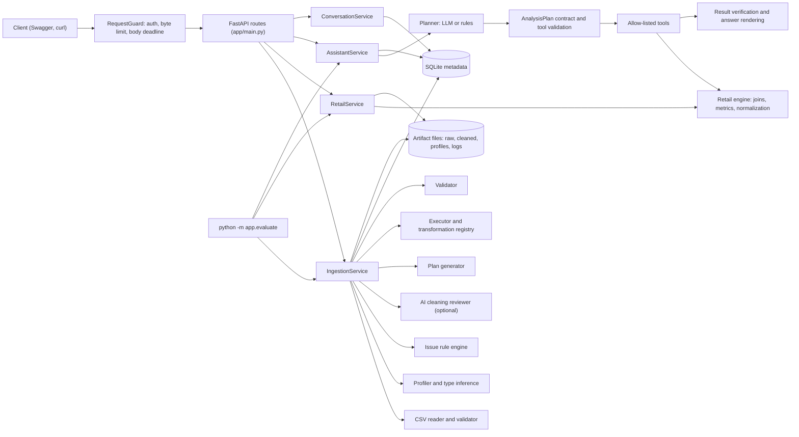
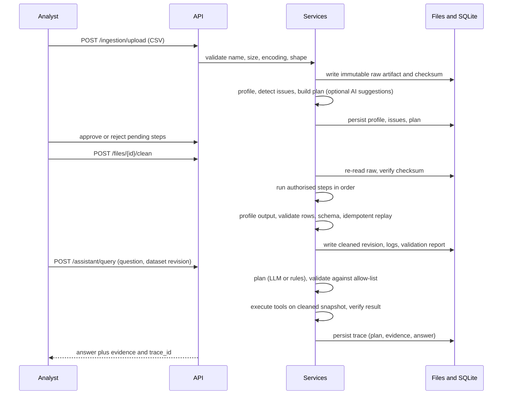

# DataPilot AI

**Clean messy retail CSVs, validate relationships, and trace every numerical chat answer back to executed computation.**

DataPilot AI is a FastAPI backend for the Naukr.AI **AI Retail Data & Conversational Intelligence Workbench** assessment (document `DQ-AI-CHAT-03`), built under the **AI Engineering** specialization. It ingests CSV exports, profiles them, proposes an auditable cleaning plan, applies approved steps through deterministic code, and answers questions through a constrained, versioned assistant.

> **Core principle (from the assessment):** the model may reason and plan; the application validates, executes and verifies. In this repository the model can only emit a JSON *plan*. Every number in an answer is computed by allow-listed Python tools over a validated cleaned artifact, and the answer text is rendered from verified tool output.

**Status at a glance**

| Item | State |
| --- | --- |
| Interface | HTTP API with Swagger UI (`/docs`). There is no dedicated frontend. |
| LLM | Optional, **off by default**. Any OpenAI-compatible `/chat/completions` endpoint. Groq `openai/gpt-oss-120b` and `qwen/qwen3.8-27b` were used in development checks. |
| Works with no paid service | Yes. The batch evaluator forces AI off; the chat assistant has a deterministic rule fallback. |
| Automated tests | 139 test functions (199 collected cases per the repo's verification reports). Not re-executed for this README; see [Testing](#13-testing-and-verified-results). |
| Walkthrough video | **Not yet recorded** (no link exists in the repo). |

---

## Contents

1. [Problem and use case](#1-problem-and-use-case)
2. [Assessment coverage (100-point rubric)](#2-assessment-coverage-100-point-rubric)
3. [Architecture](#3-architecture)
4. [Quick start](#4-quick-start)
5. [Configuration](#5-configuration)
6. [API reference and examples](#6-api-reference-and-examples)
7. [Data profiling and cleaning](#7-data-profiling-and-cleaning)
8. [Retail intelligence](#8-retail-intelligence)
9. [Conversational assistant](#9-conversational-assistant)
10. [AI versus deterministic code](#10-ai-versus-deterministic-code)
11. [LLM provider, data sent, privacy and security](#11-llm-provider-data-sent-privacy-and-security)
12. [Batch evaluator](#12-batch-evaluator)
13. [Testing and verified results](#13-testing-and-verified-results)
14. [Project structure and code quality](#14-project-structure-and-code-quality)
15. [Design decisions and trade-offs](#15-design-decisions-and-trade-offs)
16. [Limitations and future work](#16-limitations-and-future-work)
17. [Walkthrough script](#17-walkthrough-script-35-minutes)
18. [Documentation gaps and unverifiable items](#18-documentation-gaps-and-unverifiable-items)

---

## 1. Problem and use case

Retail teams receive product, order, inventory and store exports from different systems. They arrive with padded strings, case variants (`Blue` / `blue`), mixed date formats, duplicate rows and keys that do not line up. Two failure modes are costly:

* **Silent data damage.** A "helpful" cleaner drops rows or rewrites categories nobody approved.
* **Plausible but unverifiable analytics.** An LLM that reads rows and writes a persuasive total, or a join that quietly multiplies revenue.

DataPilot AI addresses both: every cleaning decision is a recorded, risk-rated step with a status; every chat answer carries the dataset revision, columns, filters, join and row counts used to compute it.

Typical analyst workflow: upload CSVs → review issues and the cleaning plan → approve or reject medium-risk steps → clean → register a declared join between datasets → ask questions or request retail metrics, with a stored trace for each answer.

---

## 2. Assessment coverage (100-point rubric)

Weights come from page 5 of the assessment PDF. **They are rubric weights, not a predicted score.** "Evidence" points to code or tests in this repository.

| Category | Pts | What this repo provides | Key code | Key tests / evaluation | Known limits |
| --- | ---: | --- | --- | --- | --- |
| Data profiling + cleaning correctness | 18 | Raw preservation with checksum; profile before/after; rule-based issue detection; plan with stable IDs, reason, columns, risk, source, status; registered deterministic transforms; row/schema/idempotency validation. See [§7](#7-data-profiling-and-cleaning). | [ingestion_service.py](app/services/ingestion_service.py), [profile_generator.py](app/profiling/profile_generator.py), [rule_engine.py](app/quality/rule_engine.py), [plan_generator.py](app/cleaning/plan_generator.py), [transformation_registry.py](app/cleaning/transformation_registry.py), [validator.py](app/validation/validator.py) | [test_cleaning.py](tests/test_cleaning.py), [test_validation.py](tests/test_validation.py), [test_quality.py](tests/test_quality.py), [test_ingestion.py](tests/test_ingestion.py) | Cleaning is synchronous. Category aliasing is not automatic. |
| Retail-domain intelligence | 14 | Three of the four listed capabilities: category/product normalization review, validated cross-dataset joins with fan-out checks, and sales/inventory analytics. See [§8](#8-retail-intelligence). | [retail_engine.py](app/retail_engine.py), [retail_service.py](app/services/retail_service.py) | [test_retail_uploaded.py](tests/test_retail_uploaded.py), [test_assessment_batch.py](tests/test_assessment_batch.py) | No recommendation explorer. No SKU/store-name normalization, conversion, sell-through or inventory ageing. |
| Chat grounding + multi-turn reasoning | 20 | Typed plans executed by allow-listed tools; answers rendered from verified results; persisted traces; follow-up edits over a versioned prior plan; join-aware questions; retail metrics through chat. See [§9](#9-conversational-assistant). | [assistant_service.py](app/services/assistant_service.py), [analysis_tools.py](app/conversation/analysis_tools.py), [followup.py](app/conversation/followup.py) | [test_assistant_analysis.py](tests/test_assistant_analysis.py), [test_module6_memory.py](tests/test_module6_memory.py) | Offline phrasing is narrow; richer phrasing needs a model. |
| Safe plan execution + AI engineering | 12 | Pydantic plan contract, field/type/operator validation, literal grounding, bounded retries, fallback, fail-closed result verification. See [§9.3](#93-plan-validation-and-failure-handling) and [§10](#10-ai-versus-deterministic-code). | [analysis_contracts.py](app/conversation/analysis_contracts.py), [analysis_planner.py](app/conversation/analysis_planner.py), [assistant.py](app/conversation/assistant.py) | [test_assistant_analysis.py](tests/test_assistant_analysis.py), [test_ai.py](tests/test_ai.py) | Live-model quality is not measured by the automated suite. |
| Batch evaluator + reliability | 10 | `python -m app.evaluate` runs the same services as the API, isolates failures per case, and emits per-case JSON. See [§12](#12-batch-evaluator). | [evaluate.py](app/evaluate.py) | [test_assessment_batch.py](tests/test_assessment_batch.py), [test_module7_reliability.py](tests/test_module7_reliability.py) | IDs and timestamps vary between runs. |
| Architecture + code quality | 10 | API / service / contract / engine / storage layering; one set of services shared by HTTP and batch; typed contracts; structured `PipelineError`. See [§3](#3-architecture), [§14](#14-project-structure-and-code-quality), [§15](#15-design-decisions-and-trade-offs). | [main.py](app/main.py), `app/services/`, `app/storage/` | [test_api_evaluation.py](tests/test_api_evaluation.py) | In-process work and single-worker SQLite limit concurrency. |
| Security / privacy / data isolation | 6 | Bearer auth before body read, owner-scoped queries, per-user storage paths, input and query limits, schema-only model payloads by default. See [§11](#11-llm-provider-data-sent-privacy-and-security). | [main.py](app/main.py), [csv_reader.py](app/ingestion/csv_reader.py), [file_storage.py](app/storage/file_storage.py) | [test_module7_reliability.py](tests/test_module7_reliability.py), [test_conversation_memory.py](tests/test_conversation_memory.py) | Static tokens; no TLS, token expiry or rate limiting. |
| Automated tests | 5 | Profiling, transformations, idempotency, safe joins, plan validation, grounded answers, multi-turn context, refusals, model failures. See [§13](#13-testing-and-verified-results). | `tests/` | `python -m pytest -q` | No load or security certification. |
| README + technical reasoning | 5 | This document. | `README.md` | n/a | Video not recorded; see [§18](#18-documentation-gaps-and-unverifiable-items). |
| **Total** | **100** | | | | |

### Requirement checklist from the PDF

Legend: **Done** = implemented in code and covered by a test or documented run. **Partial** = implemented with a stated gap. **No** = not implemented. **Unverified** = no evidence available in the repository.

| PDF requirement | Status | Where / note |
| --- | --- | --- |
| Accept CSVs and persist run, status, metadata, original and cleaned artifact | Done | `IngestionRun`, `UploadedFile`; `raw/` and `cleaned/` artifacts ([§3.3](#33-storage-layout-and-lineage)) |
| Profile before and after cleaning | Done | `GET /files/{id}/profile?kind=original\|cleaned` |
| Detect mixed types, inconsistent dates/numbers, whitespace/case, duplicates, category variants | Done | [§7.2](#72-issue-detection) |
| Cleaning plan before mutation with stable id, reason, fields, risk, source, status | Done | `Step` contract; UUIDv5 ids derived from content |
| Deterministic transforms; validate row/schema deltas and unresolved issues | Done | [validator.py](app/validation/validator.py) |
| Re-running the cleaner is stable | Partial | The validator replays completed steps over the output and requires identical data. Re-uploading a cleaned file as a new run is not covered by a dedicated test that I could confirm. |
| At least two retail capabilities | Done | Normalization review, safe joins, sales/inventory analytics |
| Recommendation / scoring explorer | **No** | Not implemented |
| Chat: filter, sort, group, aggregate, compare, top/bottom, distinct, statistics | Done | Intents `inspect`, `rows`, `aggregate`, `distinct`, `statistics`, `compare`, `retail` |
| Multi-turn follow-ups with preserved state | Done | [followup.py](app/conversation/followup.py), persisted context |
| Questions requiring validated joins | Done | `relationship_ids` on `/assistant/query` |
| Answer plus evidence (dataset/version, columns, filters, joins, operations, row counts, bounded preview) | Done | Trace `evidence` and `result_preview` |
| Refuse or clarify when unsupported/ambiguous | Done | `NEEDS_CLARIFICATION`, `UNSUPPORTED` statuses |
| Persist chat sessions, no hidden prompts or secrets | Done | Traces store the model's generated plan and attempt statuses, not prompts or keys |
| Allow-list plan validation; no arbitrary Python/SQL | Done | No code path executes model text |
| Prompt injection in a cell | Done | Cell text is never sent to the model by default; plans are schema-validated. Test: `test_schema_grounding_excludes_dataset_content` |
| Malicious/expensive plan rejected | Done | Unknown fields/operators, limits, join checks ([§9.3](#93-plan-validation-and-failure-handling)) |
| LLM outage / invalid JSON handled | Done | Retry then rule fallback; tested for timeout, 503, 429, invalid JSON |
| Raw vs cleaned made explicit | Done | The assistant only queries validated cleaned revisions and cites `revision`, `artifact_id`, `sha256` |
| One-command batch evaluator calling production services | Done | `python -m app.evaluate ...` |
| One failed case does not abort the batch | Done | Per-case try/except |
| Output includes dataset, profile_before, issues, cleaning_plan, profile_after, validation, chat_evaluation, artifacts | Done, with shape differences | Per-case lists per file; each chat item has `plan`/`answer` under `result` and a separate `trace` ([§12](#12-batch-evaluator)) |
| Async/background handling for long jobs | **No** | Synchronous, in-process ([§16](#16-limitations-and-future-work)) |
| Idempotency | Done | `Idempotency-Key` header on upload; idempotent `clean`; deterministic relationship IDs |
| Bounded memory / 100k+ rows | Partial | Limits default to 200,000 rows and 20 MiB per file; the largest ingestion test uses 12,000 rows |
| Secrets in environment variables | Done | `.env` is git-ignored; see [§5](#5-configuration) |
| File type/size/path validation, per-user isolation | Done | [§11.3](#113-security-controls) |
| Minimise PII sent to models and document it | Done | [§11.2](#112-what-leaves-the-system) |
| Sample datasets, tests, `.env.example` | Done | `examples/`, `tests/`, `.env.example` |
| Meaningful commit history, clean-clone setup | **Unverified** | The ZIP has no `.git` directory; see [§18](#18-documentation-gaps-and-unverifiable-items) |
| 3–5 minute walkthrough video | **No** | Script in [§17](#17-walkthrough-script-35-minutes) |

**AI Engineering track mapping:** tool orchestration (typed plan → allow-listed tools), validated structured outputs (`AnalysisPlan`), context management (versioned conversation context with compare-and-set), retries/fallbacks, prompt-injection defenses (schema-only payloads, literal grounding), and an eval harness for chat quality (batch chat checks and `scripts/evaluate_conversation_memory.py`).

---

## 3. Architecture

### 3.1 Component view



The batch CLI instantiates the same `IngestionService`, `RetailService`, `ConversationService` and `AssistantService` classes as the API ([evaluate.py](app/evaluate.py)). There is no separate evaluator implementation.

### 3.2 End-to-end workflow



### 3.3 Storage layout and lineage

Metadata lives in SQLite (`<STORAGE_DIR>/metadata.db` unless `DATABASE_URL` is set). Artifacts are files, isolated per user and run:

```text
<STORAGE_DIR>/<sha256(user)[:32]>/<run_id>/
  raw/<file_id>.csv                       original bytes, never modified
  cleaned/<revision_id>.csv               one immutable file per clean() call
  artifacts/profiles/<profile_id>.json    original and cleaned profiles
  artifacts/issues/<file_id>.json
  artifacts/plans/<plan_id>.json
  artifacts/logs/<revision_id>.json       per-step execution log
  artifacts/validation/<revision_id>.json validation report
```

Writes are atomic (temp file, `fsync`, then hard link/rename that refuses to overwrite). Each `clean()` **rebuilds from the raw file** after re-checking its SHA-256, so a later approval never re-applies a destructive step to cleaned output. Chat answers record `file_id`, `run_id`, `revision`, `artifact_id`, `profile_id` and the cleaned artifact's `sha256`, which gives a lineage from answer back to raw upload.

---

## 4. Quick start

Requirements: Python with the packages in [requirements.txt](requirements.txt) (`fastapi`, `uvicorn`, `pandas`, `pydantic`, `SQLAlchemy`, `python-multipart`, `httpx`, `pytest`). The project's reports verify **Python 3.14.7 on Windows**; other Python versions and operating systems were not exercised by the authors' reports.

**The application reads real environment variables only; `.env` is not auto-loaded.** Do not `source .env` in bash: its `API_TOKENS` JSON loses its quotes. Export variables explicitly as below.

### Linux / macOS (bash)

```bash
python -m venv .venv
source .venv/bin/activate
pip install -r requirements.txt

export STORAGE_DIR=./data
export AI_ENABLED=false
export TOKEN="$(python -c 'import secrets; print(secrets.token_hex(16))')"
export API_TOKENS="{\"$TOKEN\":\"assessment-user\"}"
echo "$TOKEN"                      # paste into Swagger "Authorize"

python -m uvicorn app.main:app --host 127.0.0.1 --port 8000 --workers 1
```

### Windows (PowerShell)

```powershell
python -m venv .venv
.\.venv\Scripts\python.exe -m pip install -r requirements.txt
$env:STORAGE_DIR = './data'
$env:AI_ENABLED = 'false'
$token = [Guid]::NewGuid().ToString('N')
$env:API_TOKENS = @{ $token = 'assessment-user' } | ConvertTo-Json -Compress
$token
.\.venv\Scripts\python.exe -m uvicorn app.main:app --host 127.0.0.1 --port 8000 --workers 1
```

Then open <http://127.0.0.1:8000/docs>, click **Authorize**, paste the token. `GET /health` (`{"status":"ok"}`), `/docs` and `/openapi.json` need no token; everything under `/api/v1` does.

**No-token local mode:** `DEV_MODE=true` (with no `Authorization` header) maps requests to the user `local-development-user`. Do not use it on a shared machine.

**Always run with `--workers 1`.** The service uses an in-process lock and a local SQLite file; multiple workers are not supported.

### Run the batch evaluator (no server, no AI)

```bash
python -m app.evaluate --input cases.json --output results.json --artifacts-dir ./evaluation_output
```

> `./evaluation_output` already contains tracked Olist fixtures under `evaluation_output/olist/` and `evaluation_output/module2/`, which the Olist regression tests and the Olist assistant read. The evaluator adds `metadata.db` and per-user run directories beside them. Do not delete those two folders. For a throwaway run use another directory, for example `--artifacts-dir ./eval_scratch`.

### Run the tests

```bash
python -m pytest -q
```

On Windows, earlier verification used a workspace-local pytest temp directory because the default temp location produced permission errors: `python -m pytest -q --basetemp "data/pytest-run1"`.

---

## 5. Configuration

All settings are read from environment variables in [app/config.py](app/config.py); [.env.example](.env.example) lists them with defaults.

| Variable | Default | Meaning |
| --- | --- | --- |
| `STORAGE_DIR` | `data` | Artifact root; also holds `metadata.db` by default |
| `DATABASE_URL` | `sqlite:///<STORAGE_DIR>/metadata.db` | SQLAlchemy URL. Only SQLite is exercised |
| `API_TOKENS` | `{}` | JSON object `{"<token>": "<user id>"}`; user id 1–64 chars. Server-managed, not self-service |
| `DEV_MODE` | `false` | `true` allows unauthenticated `/api/v1` calls as `local-development-user` |
| `MAX_FILE_BYTES` | `20971520` (20 MiB) | Per-file limit |
| `MAX_REQUEST_BYTES` | `104857600` (100 MiB) | Per-request limit |
| `MAX_MULTIPART_PARTS` | `4096` | Max files/fields per upload |
| `API_BODY_TIMEOUT_SECONDS` | `30` | Deadline for receiving a request body |
| `MAX_ROWS` | `200000` | Per-CSV row limit; also caps projected join output rows |
| `MAX_COLUMNS` | `500` | Per-CSV column limit |
| `MAX_CELLS` | `5000000` | Rows × columns limit |
| `AI_ENABLED` | `false` | Master switch for any outbound model call |
| `AI_PROVIDER` | `openai-compatible` | The only supported value |
| `AI_BASE_URL` | `https://api.openai.com/v1` | Base URL; `/chat/completions` is appended |
| `AI_MODEL` | *(empty)* | Required when AI is enabled |
| `AI_API_KEY` | *(empty)* | Required when AI is enabled; never logged |
| `AI_INCLUDE_SAMPLES` | `false` | Opt-in: send short, heuristically redacted sample values with cleaning review requests |

Not configurable through environment variables (constants in `Settings`): model timeout **15 s** and **2 attempts** (capped at 3).

Example for Groq (set in the shell, not committed):

```bash
export AI_ENABLED=true AI_PROVIDER=openai-compatible
export AI_BASE_URL=https://api.groq.com/openai/v1
export AI_MODEL=openai/gpt-oss-120b
export AI_API_KEY=...            # your key
```

When the host is `api.groq.com`, requests use `max_completion_tokens` and `reasoning_effort` (`low` for `openai/gpt-oss-*`, `none` for `qwen/qwen3.8-27b`); other hosts use `max_tokens`.

---

## 6. API reference and examples

Base path `/api/v1`. All routes below require `Authorization: Bearer <token>`. Errors use one envelope: `{"error": {"code": "...", "message": "...", "details": {}}}`.

### 6.1 Endpoints

| Method and path | Purpose |
| --- | --- |
| `POST /ingestion/upload` | Multipart upload. Field `files` (repeatable), optional query `delimiter` (`,` `;` tab `\|`), optional form `descriptions`, optional header `Idempotency-Key`. Returns **201** with the run |
| `GET /ingestion/{run_id}`, `/files`, `/report` | Run status, files, full report |
| `GET /files/{file_id}/profile?kind=original\|cleaned` | Profile |
| `GET /files/{file_id}/issues` | Detected issues |
| `GET /files/{file_id}/cleaning-plan` | Plan steps with status |
| `GET /files/{file_id}/cleaning-plan/preview` | Dry-run of pending steps; changes nothing |
| `POST /files/{file_id}/cleaning-plan/steps` | Propose a registered operation (always needs approval) |
| `GET /files/{file_id}/approvals`, `/approvals/history` | Pending steps; decision history |
| `POST /cleaning-steps/{step_id}/approve` or `/reject` | Body `{"reason": "..."}` |
| `POST /cleaning-steps/approve` | Batch approve: `{"step_ids": [...], "reason": "..."}` |
| `POST /files/{file_id}/clean` | Run authorised steps; returns the validation report |
| `GET /files/{file_id}/validation`, `/download` | Validation report; validated cleaned CSV |
| `POST /retail/normalization` | Category/product variant review with optional approved mapping file |
| `POST /retail/relationships/discover` | Unverified join-key hints from sampled values |
| `POST /retail/relationships` | Register a join after full key validation |
| `GET /retail/relationships`, `/{id}/preview` | List; preview matched record pairs |
| `POST /retail/metrics` | Compute retail metrics with evidence |
| `POST /assistant/query` | Versioned analytical question (main chat endpoint) |
| `GET /assistant/traces/{trace_id}` | Stored trace (owner only) |
| `POST/GET /conversations`, `GET/PATCH/DELETE /conversations/{id}` | Conversation lifecycle |
| `POST /conversations/{id}/messages` | Older message API (single CSV via `file_id`, or the Olist fixture domain) |
| `GET /assistant/retail/metrics`, `POST /assistant/retail/query` | Fixed-catalog Olist analytics over committed fixtures (see [§8.4](#84-olist-fixture-analytics)) |

### 6.2 Example session (curl)

These calls match the route and contract definitions in `app/main.py` and `app/retail_contracts.py`. The expected values come from [Reports/ASSESSMENT_EXAMPLE_VALIDATION.md](Reports/ASSESSMENT_EXAMPLE_VALIDATION.md) and [cases.json](cases.json); this README's author did **not** execute them. `jq` is used only to pick IDs.

```bash
B=http://127.0.0.1:8000/api/v1; H="Authorization: Bearer $TOKEN"

# 1. Upload, then read profile, issues and plan
RUN=$(curl -s -H "$H" -F "files=@examples/teams.csv" -H "Idempotency-Key: demo-1" $B/ingestion/upload)
TEAMS=$(echo "$RUN" | jq -r '.files[0].file_id')
curl -s -H "$H" "$B/files/$TEAMS/profile?kind=original"
curl -s -H "$H" $B/files/$TEAMS/issues
curl -s -H "$H" $B/files/$TEAMS/cleaning-plan

# 2. Reject the ambiguous Blue/blue normalization, then clean
STEP=$(curl -s -H "$H" $B/files/$TEAMS/cleaning-plan | jq -r '.steps[] | select(.operation=="category_normalization") | .id')
curl -s -H "$H" -H 'Content-Type: application/json' -d '{"reason":"No authoritative category mapping"}' \
  $B/cleaning-steps/$STEP/reject
curl -s -X POST -H "$H" $B/files/$TEAMS/clean
curl -s -H "$H" $B/files/$TEAMS/validation
curl -s -H "$H" -o teams-cleaned.csv $B/files/$TEAMS/download
```

Expected for `teams.csv` (from the validation report): 3 rows before and after, whitespace around `North` trimmed, both `Blue` and `blue` preserved, validation `passed` with `idempotent: true`.

```bash
# 3. Safe join and retail metrics (sales.sku -> products.product_code)
SALES=...; PRODUCTS=...     # file_ids from uploading + cleaning examples/assessment_sales.csv and assessment_products.csv
REL=$(curl -s -H "$H" -H 'Content-Type: application/json' -d "{\"left_file_id\":\"$SALES\",\"right_file_id\":\"$PRODUCTS\",\"left_keys\":[\"sku\"],\"right_keys\":[\"product_code\"],\"cardinality\":\"many_to_one\"}" \
  $B/retail/relationships | jq -r .relationship_id)
curl -s -H "$H" -H 'Content-Type: application/json' -d "{\"file_id\":\"$SALES\",\"relationship_id\":\"$REL\",\"metrics\":[\"total_revenue\",\"category_performance\",\"return_rate\"],\"fields\":{\"revenue\":{\"column\":\"revenue\"},\"category\":{\"column\":\"category\",\"side\":\"right\"}}}" \
  $B/retail/metrics
```

Expected: total revenue `37`; Clothing `27`, Tools `10`; `return_rate` `UNSUPPORTED` (no return fields supplied) with `missing_evidence` entries.

```bash
# 4. Multi-turn chat with evidence
CONV=$(curl -s -H "$H" -H 'Content-Type: application/json' -d '{}' $B/conversations | jq -r .conversation_id)
curl -s -H "$H" -H 'Content-Type: application/json' \
  -d "{\"conversation_id\":\"$CONV\",\"question\":\"Show revenue by region\",\"datasets\":[{\"file_id\":\"$SALES\",\"revision\":1}]}" $B/assistant/query
curl -s -H "$H" -H 'Content-Type: application/json' -d "{\"conversation_id\":\"$CONV\",\"question\":\"Filter to West\"}" $B/assistant/query
curl -s -H "$H" -H 'Content-Type: application/json' -d "{\"conversation_id\":\"$CONV\",\"question\":\"Now show average revenue\"}" $B/assistant/query
curl -s -H "$H" $B/assistant/traces/<trace_id>
```

Expected values, from the validation report and `cases.json`: **37** (3 rows), then **30** (2 rows), then **15** (2 rows). Requesting `"revision": 2` on a file that is still at revision 1 returns **409 `DATASET_VERSION_CONFLICT`** with a trace whose `execution` is `NOT_STARTED`.

---

## 7. Data profiling and cleaning

### 7.1 Ingestion and profiling

* **Validation** ([csv_reader.py](app/ingestion/csv_reader.py)): safe basename (no path separators, `:` or NUL), `.csv` extension, non-empty, byte, row, column and cell limits; delimiter sniffing or explicit; UTF-8 (with BOM), UTF-16 (BOM) or cp1252 fallback; rejects binary control characters and HTML/JSON bodies; strict CSV parsing (a record of the wrong width is a `MALFORMED_CSV` error); duplicate and empty headers are renamed deterministically (`name__2`, `unnamed_N`).
* **Nulls:** only physically empty cells are null; literal `NA` or `null` strings stay data.
* **Per-column profile** ([profile_generator.py](app/profiling/profile_generator.py)): type inference (physical and semantic type, identifier detection), null count/percentage, unique count and cardinality ratio, top values (≤10) and samples (≤5), whitespace count, case-variant groups, fuzzy near-duplicate pairs (difflib ratio ≥ 0.85 over the 30 most frequent values), rare categories; numeric min/max/mean/median/std, quantiles, 5-bin distribution, invalid count and 1.5×IQR outliers; date parse counts, invalid and ambiguous counts, format mix and range.
* **File-level:** row/column counts, duplicate rows, empty rows, missing cells, duplicate headers.
* A **cleaned profile** is generated from the cleaned data for every revision, so before/after comparison is a diff of two stored profiles.

### 7.2 Issue detection

[rule_engine.py](app/quality/rule_engine.py) emits issues with a stable id (`uuid5(file_id:column:category)`), severity, affected count and percentage, bounded evidence and a recommended action. Categories: `duplicate_rows`, `empty_rows`, `duplicate_headers`, `malformed_records`, `missing_values`, `whitespace`, `empty_column`, `constant_column`, `mixed_types`, `duplicate_identifiers`, `case_inconsistency`, `category_variants`, `invalid_numeric`, `potential_outliers`, `invalid_dates`, `ambiguous_dates`, `inconsistent_date_formats`.

### 7.3 Cleaning plan

Each step ([models/contracts.py](app/models/contracts.py)) has `id`, `issue_ids`, `operation`, `columns`, `parameters`, `reason`, `source` (`CODE` or `AI`), `risk`, `approval_required`, `expected_impact` and `status`. Step ids are `uuid5` over `[file_id, source, operation, columns, parameters, risk]`, so regenerating the plan yields the same ids.

| Operation | Default risk | Behaviour |
| --- | --- | --- |
| `trim_whitespace` | low (auto-approved) | Strip; empty string becomes null |
| `remove_empty_rows` | low (auto-approved) | Drop rows that are entirely null |
| `remove_exact_duplicates` | low (auto-approved) | Drop exact duplicate rows, keep first |
| `flag_outliers` | low (auto-approved) | Audit metadata only; **never changes values** |
| `convert_numeric` | medium (approval) | Canonical decimal text; fails the step on invalid values; identifier-like columns are skipped |
| `parse_dates` | medium (approval) | ISO-8601. Code proposes it only for columns with no invalid or ambiguous dates; ambiguous values fail unless an explicit format is given |
| `category_normalization` | medium (approval) | Explicit `{source: target}` mapping; chains and cycles rejected. Code proposes mappings only for case-equivalent values |
| `normalize_strings` | medium (approval) | `lower`, `upper` or `casefold` |
| `fill_missing` | medium (approval) | Constant fill; **AI may not propose it** |

Policy details:

* AI-sourced steps are never below **medium** risk, so they always wait for a human decision. High-risk steps cannot be approved (`HIGH_RISK_BLOCKED`, 403). `Settings.risk_overrides` can raise risk but is not exposed through environment variables.
* Pending or rejected steps are **skipped** during `clean`; the original values survive. A `FAILED` step is retried on later revisions rather than silently dropped.
* Row-removing steps are ordered last so that formatting steps cannot create duplicates that only a second pass would remove.
* `GET .../cleaning-plan/preview` dry-runs each pending step independently on a copy.

### 7.4 Execution and validation

[executor.py](app/cleaning/executor.py) rejects any transformation that changes the schema, adds rows, reorders rows (unless the operation removes rows), removes rows other than by its exact predicate, or touches columns outside its scope. After all steps run, [validator.py](app/validation/validator.py) produces a report and fails with codes such as:

| Error code | Meaning |
| --- | --- |
| `UNEXPLAINED_ROW_CHANGE` | Row delta differs from the sum of logged step row losses |
| `UNEXPLAINED_SCHEMA_CHANGE` | Column list changed |
| `EXECUTION_FAILURES` | At least one step failed |
| `NON_IDEMPOTENT_PLAN` | Replaying completed steps over the output changed the data |
| `CSV_ROUNDTRIP_FAILURE` | Written CSV re-parses to different data |

The report also carries before/after row and column counts, types, null counts, duplicate counts, executed steps with rows affected, and `unresolved_issues` (issues still detected on the cleaned data). `GET .../download` and the assistant refuse any revision whose validation did not pass.

**Failure isolation:** if cleaning raises, the file becomes `FAILED` with `EXECUTION_ERROR`, the original artifact stays untouched, and an interrupted `CLEANING` state can be recovered offline with `python -m app.recover --user <id> --file-id <id>` (stop API workers first).

---

## 8. Retail intelligence

Implemented capabilities, mapped to the PDF's list:

| PDF capability | Status | Implementation |
| --- | --- | --- |
| Product / category normalization | Partial | Review-and-approve workflow (§8.1). No built-in alias dictionary (for example `Tee` to `T-Shirt`), SKU formatting or store-name normalization |
| Cross-dataset relationships | Done | Declared keys, cardinality and fan-out validation (§8.2) |
| Retail performance / recommendation explorer | **No** | Not implemented |
| Sales / inventory analytics | Partial | Revenue, AOV, order count, units, return rate, availability, stock-out frequency, category and store performance (§8.3). No conversion, sell-through or inventory ageing |

### 8.1 Normalization review

`POST /retail/normalization` (`entity`: `product` or `category`) lists the distinct values of a column with a status per value: `MAPPED` (an approved mapping applies), `UNCERTAIN` (other spellings share the same case/whitespace-folded form), `UNTRANSLATED`, or `MISSING_SOURCE`. A mapping is supplied as another validated dataset with source and canonical columns plus an `approval_reason`; it is an exact lookup, and chains or cycles are rejected. Case and whitespace similarity are **hints, not merges**, so uncertainty is preserved. Validated AI suggestions from the upload plan are listed but never applied here.

### 8.2 Safe joins

`POST /retail/relationships` takes `left_keys`, `right_keys` (≤5 pairs), `join_type` (`left` or `inner`) and a declared `cardinality` (`one_to_one`, `many_to_one`, `one_to_many`). [validate_join](app/retail_engine.py) checks the full keys, not a sample, and records: observed cardinality, missing keys, duplicate-key rows, unmatched rows on each side, fan-out rows, max matches per row and projected output rows. It rejects the join when:

* duplicates violate the declared side (`UNSAFE_JOIN_CARDINALITY`), or both sides contain duplicates (many-to-many);
* projected rows exceed `MAX_ROWS` (`JOIN_ROW_LIMIT`).

Relationship ids are deterministic (`uuid5` of user, definition and pinned source artifacts). Registered joins pin each side's artifact id and **SHA-256**; changed data is rejected (`RETAIL_ARTIFACT_CHANGED`). Metrics and chat additionally call `require_base_grain`, which raises `UNSAFE_METRIC_JOIN` unless the join returns every base row exactly once. `POST /retail/relationships/discover` only suggests candidate keys (marked `UNVERIFIED`, based on up to 500 sampled values per column).

### 8.3 Metrics

Computed with `Decimal` arithmetic in [retail_engine.py](app/retail_engine.py). The caller maps roles to columns (`revenue`, `unit_price`, `quantity`, `order_id`, `return_status`, `on_hand`, `category`, `store`); nothing is guessed.

| Metric | Formula | Required roles |
| --- | --- | --- |
| `total_revenue` | Σ revenue, or Σ(unit_price × quantity) if `revenue` is unmapped | `revenue` or `unit_price`+`quantity` |
| `order_count` | Distinct order ids | `order_id` |
| `average_order_value` | Revenue ÷ distinct orders (4 dp) | revenue basis, `order_id` |
| `units_sold` | Σ non-negative integer quantity | `quantity` |
| `return_rate` | 100 × orders with ≥1 returned line ÷ distinct orders | `order_id`, `return_status`, plus **explicit** `returned_values` and `non_returned_values` |
| `inventory_availability` | 100 × observations with on-hand > 0 ÷ observations | `on_hand` |
| `stock_out_frequency` | 100 × observations with on-hand = 0 ÷ observations | `on_hand` |
| `category_performance`, `store_performance` | Revenue grouped by dimension; blank dimension values go to an `Unclassified` bucket | revenue basis + `category` or `store` |

Every metric returns `status` (`OK` or `UNSUPPORTED`), `value` and `evidence`: source datasets and revisions, source fields, filters, join, formula, `records_considered` and `missing_evidence`. Missing role mappings, invalid numeric values, unknown return statuses, zero denominators, more than 1,000 groups, or measure fields taken from the joined side produce `UNSUPPORTED` with reasons instead of estimates. Measures must come from the base dataset; only `category` and `store` may come from the right side.

### 8.4 Olist fixture analytics

`POST /assistant/retail/query`, `GET /assistant/retail/metrics` and `analytics_domain: "olist_retail"` on the older conversation API answer from a **fixed metric catalog** over committed Olist summaries (`evaluation_output/module2/olist-summary*.json`, with the five cleaned CSVs under `evaluation_output/olist/handoff/cleaned/` used for regression). These endpoints do **not** analyse user-uploaded files. They support delivered/cancelled counts, status distribution, delivered merchandise/freight/payment values, category rankings, month comparisons, and a payment-reconciliation explanation that states differences without inferring causes. They are demonstration material for retail-context conversation; the upload pipeline above is the primary system.

---

## 9. Conversational assistant

### 9.1 Endpoints

* **`POST /assistant/query` (primary).** Body: `question` (≤2000 chars), optional `datasets` (≤5, each `{file_id, revision?}`), optional `relationship_ids` (≤3), optional `conversation_id`. At least datasets or an owned conversation is required. It also accepts the older body `{file_id, question}` for a simple single-file query.
* **`POST /conversations/{id}/messages`.** Older message API; used by `scripts/evaluate_conversation_memory.py`.

### 9.2 Supported intents

The model (or rule fallback) produces an [`AnalysisPlan`](app/conversation/analysis_contracts.py). The service validates it and runs the matching tool:

| Intent | Computation |
| --- | --- |
| `inspect` | Column names and types |
| `rows` | Projected columns, optional sort, ≤50 rows |
| `aggregate` | `row_count`, `sum`, `average`, `min`, `max`, `count_distinct`; optional `group_by`, sort, limit (top/bottom) |
| `distinct` | Distinct non-blank values |
| `statistics` | count, nulls, min, max, mean, median, population std-dev |
| `compare` | Same aggregate over two filtered cohorts; reports A, B and A − B |
| `retail` | Any of the §8.3 metrics on the (optionally joined) cohort |
| `clarify`, `unsupported` | Non-executing outcomes |

Filters: `eq`, `ne`, `contains`, `gt`, `gte`, `lt`, `lte`, `is_null`, `is_not_null` (retail filters accept only `eq` and `is_null`). Filters combine with AND. Numeric math uses `Decimal`.

### 9.3 Plan validation and failure handling

The example plan in the PDF has the same shape as this repository's plan, with different field names. Before anything runs, the service applies these checks, in order of appearance in [assistant_service.py](app/services/assistant_service.py) and [analysis_tools.py](app/conversation/analysis_tools.py):

| Threat or condition | Control | Outcome |
| --- | --- | --- |
| Unknown intent/operator/extra fields | `Contract` models with `extra="forbid"` and `Literal` enums | `INVALID_QUERY_PLAN` (422) |
| Column not in schema, or numeric op on text | `validate_tools` binds every referenced field per side | `INVALID_QUERY_PLAN` / `INVALID_QUERY_TYPE` |
| Model picks a column it was not shown | Compared to the schema actually presented in the prompt | `UNGROUNDED_COLUMN` |
| Model invents a filter value | Every literal must appear in the user's question (or in prior verified context) | `UNGROUNDED_FILTER` |
| Wrong dataset or stale revision | Plan dataset/revision must equal the selected cleaned revision; artifact checksum re-verified | `DATASET_VERSION_CONFLICT` (409) |
| Unsafe join | Registered relationship only; base-grain check | `UNSAFE_METRIC_JOIN` |
| Expensive work | `limit` ≤ 50, ≤10 filters, ≤1,000 groups, ≤5 datasets, ≤3 relationships, bounded number size | `ANALYTICAL_GROUP_LIMIT` and others |
| Tool result inconsistent with its contract | Result verifier re-checks counts and numeric types before rendering the answer | `RESULT_VERIFICATION_FAILED` (fails closed) |
| Not a validated dataset | Only owned files with a passed validation report can be queried | `NOT_READY` (409) |

**Ambiguous or unanswerable questions** return HTTP 200 with `status: NEEDS_CLARIFICATION` or `UNSUPPORTED` and a targeted message rather than guessing a column. In the sample batch, `"What about the other one?"` is expected to return `NEEDS_CLARIFICATION`.

**Model failures** (timeout, HTTP 5xx/408, 429, non-JSON, truncated output, oversized response): up to two attempts with a 15 s timeout; 429 and other 4xx stop retrying; then the **rule planner** runs. The trace records `planner.attempts` and `plan_source` (`AI`, `RULES` or `CONVERSATION_RULES`). Deterministic data operations remain available with AI off. The rule planner accepts only narrow, fully recognised phrasings (for example `show <numeric col> by <col>`, `sum of <col>`, `how many rows`, `distinct <col>`, `describe <col>`, `<aggregate> where <col> = value`) and otherwise asks for clarification.

**Raw vs cleaned:** the assistant never reads raw files. Every answer names the cleaned `revision`, `artifact_id` and `sha256`, so the result is reproducible against a fixed artifact.

### 9.4 Multi-turn context

Conversation state is persisted with a context version (compare-and-set; concurrent turns serialise). A follow-up such as `Filter to West`, `Now show average revenue`, `Only where amount > 5`, `Clear all filters`, `Show top 5`, `Compare North and South` is resolved by [followup.py](app/conversation/followup.py), which edits the **last verified plan** instead of asking a model to remember. Changes are validated by the same contract and tools as a fresh plan. If a reference cannot be resolved (`"What about the other one?"`), state is preserved and a clarification is returned. A failed turn does not replace the stored context; a request for a different revision of the same dataset triggers `DATASET_VERSION_CONFLICT` instead of silently mixing versions.

### 9.5 Answer, evidence and trace

Each response returns `trace_id`, `status`, `intent`, `plan`, `result`, `answer` and `evidence`. The stored trace (`GET /assistant/traces/{trace_id}`, owner only) contains:

| Field | Content |
| --- | --- |
| `question`, `requested_scope` | What was asked and which datasets/relationships were selected |
| `generated_plan`, `planner` | Raw model JSON (truncated) and attempt/status list |
| `plan_source`, `context_resolution` | `AI`, `RULES` or `CONVERSATION_RULES` and the edit applied |
| `validated_plan`, `operations` | Plan that passed validation; tools run (for example `aggregate`, `sum`, `validated_join`) |
| `evidence` | `source_datasets` (file, run, filename, revision, artifact id, profile id, sha256), `columns_used`, `filters`, `join` (with fan-out stats), `records_scanned`, `records_considered` |
| `result_preview` | Bounded result (≤50 items, long cells truncated to 200 chars) |
| `answer`, `status`, `execution`, `error` | Rendered answer; `NOT_STARTED` / `STARTED` / `VERIFIED` / `FAILED` |

Prompts, API keys and provider responses beyond the parsed plan are not stored.

**Retail context in chat:** with `intent: retail`, the same endpoint computes the §8.3 metrics over a (joined) cohort and states the formula and missing evidence in the trace. This is the retail-conversation flow cited for the assessment.

---

## 10. AI versus deterministic code

| Responsibility | AI (optional) | Deterministic code |
| --- | --- | --- |
| Interpret a question | Propose a JSON plan | Validate the plan, bind fields, execute, verify, render the answer |
| Counts, filters, joins, aggregates, statistics, retail metrics | **Never** | Always |
| Duplicate detection, schema checks, scoring arithmetic | **Never** | Always |
| Cleaning suggestions | Suggest ≤5 mappings or conversions and explain them | Issue detection; assign risk (AI ≥ medium); require approval; apply registered transforms; validate output |
| Approve or reject steps | **Never** | Human decision recorded in `Approval` |
| Answer wording | Not used | Rendered from verified tool output |
| Outage or invalid output | n/a | Retry, then rule planner; failures recorded in the trace |

No model output is executed as code or SQL. The model's cleaning suggestions are checked against the registry, restricted to columns it was shown, must not use `fill_missing`, and category mappings must use exact, visible, unredacted sample values.

---

## 11. LLM provider, data sent, privacy and security

### 11.1 Provider and model

Any OpenAI-compatible Chat Completions endpoint (`AI_BASE_URL`, `AI_MODEL`, `AI_API_KEY`). Requests use `temperature: 0` and `response_format: {"type":"json_object"}`. Development checks in the repository's reports used Groq with `openai/gpt-oss-120b` and `qwen/qwen3.8-27b` on synthetic data. No model is required for tests, evaluation or the rule fallback.

### 11.2 What leaves the system

Only when `AI_ENABLED=true` with a key and model configured:

| Call | Payload | Not sent |
| --- | --- | --- |
| Chat planning (`/assistant/query`) | The question; for each selected dataset an alias, **filename** (≤120 chars), revision and **column names with inferred types**; relationship aliases and right-side column types; the metric-to-role catalog; for follow-ups a compact prior plan (which can contain filter literals). Payload is capped at ~4.8 KB and trimmed if larger | Cell values, row data, results, counts |
| Cleaning review (upload) | Up to 20 columns: name, null count, unique count, inferred type and role; issue category counts. Budget 3,200 bytes | Samples, unless `AI_INCLUDE_SAMPLES=true` |
| Cleaning review with samples enabled | Up to 5 short (≤100 char) sample values per non-identifier column, with email-like and long digit sequences replaced by `[email]` / `[number]` (heuristic, not guaranteed anonymisation) | Values from columns detected as identifiers |
| Older message API (`ai_plan`) | Question plus column name, semantic type and numeric flag per column | Values |
| Olist retail planner | Question plus the metric catalog (definitions) | Analytics values |

Column names, filenames and question text may themselves be sensitive; there is no automatic redaction of them. Raw and cleaned files, full profiles, traces and results stay in local storage. `test_schema_grounding_excludes_dataset_content` asserts that a hostile cell value and numeric cell values do not appear in the planner payload.

### 11.3 Security controls

* **Authentication before body parsing** (`RequestGuard`): constant-time bearer comparison; unauthenticated requests get 401 before a body is read. Declared and streamed bytes are bounded (413) and the body must arrive within `API_BODY_TIMEOUT_SECONDS` (408).
* **Isolation:** every lookup joins on the owning user (`owned_file`, `owned_run`, trace and relationship owner checks); a foreign id returns 404. Artifact paths are `sha256(user)`-prefixed and resolved to stay under the storage root. Conversation, trace and relationship access are owner-scoped, covered by `test_owner_isolation_for_conversations_messages_and_files` and `test_full_http_workflow_and_isolation`.
* **Untrusted input:** filenames, cell text, plans and model output are validated; dataset text is treated as data; the planner system prompts label schema and question as untrusted.
* **Limits:** file, request, rows, columns, cells, multipart parts, idempotency-key length, plan limits and join row limit (§5, §9.3).
* **Errors:** structured envelope; unexpected exceptions are logged by type only and returned as `INTERNAL_ERROR`. Logs avoid prompts, samples, URLs and keys.
* **Secrets:** environment variables only; `.env` is git-ignored; `AI_API_KEY` and `API_TOKENS` are excluded from the settings `repr`.
* **Customer analytics:** the metrics are explicit retail signals computed from declared columns. The system does not infer protected traits and has no customer scoring.
* **Not provided:** TLS, token expiry/rotation, per-tenant rate limits, a real identity provider. Tokens are a static server-side map suitable for local or reviewed deployment only.

---

## 12. Batch evaluator

```bash
python -m app.evaluate --input cases.json --output results.json --artifacts-dir ./evaluation_output
```

Prints `{"case_count": N, "passed": M, "output": "results.json"}` and writes the full JSON to `--output`. It runs with **AI disabled** and its own metadata database in `--artifacts-dir`, regardless of server environment. It needs no token.

### 12.1 Input

```jsonc
{ "cases": [ {
    "id": "sales-products-and-conversation",
    "files": ["examples/assessment_sales.csv", "examples/assessment_products.csv"],  // relative to the cases file, regular files only
    "delimiter": null,
    "approve_operations": [], "reject_operations": [],   // approve/reject pending steps by operation name (evaluation-only convenience)
    "retail": [ { "file_index": 0,
                  "join": {"right_file_index": 1, "left_keys": ["sku"], "right_keys": ["product_code"], "cardinality": "many_to_one"},
                  "request": {"fields": {"revenue": {"column": "revenue"}}},
                  "expected_metrics": {"total_revenue": {"value": "37"}} } ],
    "chat": [ {"question": "Show revenue by region", "file_index": 0, "expected_value": "37"},
              {"question": "What about the other one?", "expected_status": "NEEDS_CLARIFICATION"} ]
} ] }
```

`chat[].expected_status` is one of `ANSWERED` (default), `NEEDS_CLARIFICATION`, `UNSUPPORTED`, `FAILED`. Paths that escape the case directory, absolute paths and oversize files are rejected per case. [cases.json](cases.json) is the assessment sample (sales + products with a join, plus a measurements/teams approval-policy case). [examples/cases.json](examples/cases.json) is a second, older sample whose paths are relative to `examples/`.

### 12.2 Output

```jsonc
{ "case_count": 2, "passed": 2,
  "results": [ {
    "id": "...", "success": true,
    "dataset": [...],          // per-file run entries
    "profile_before": [...], "issues": [...], "cleaning_plan": [...],
    "profile_after": [...],    "validation": [...],
    "chat_evaluation": [ { "question": "...", "status": "ANSWERED", "passed": true,
                           "expected_status": "ANSWERED", "expected_value": "37",
                           "result": { "plan": {...}, "answer": "...", "evidence": {...} },
                           "error": null, "trace": {...} } ],
    "retail_evaluation": [...], "file_errors": {},
    "artifacts": { "root": "artifacts-dir", "metadata": "metadata.db", "files": [ { "raw": "...", "cleaned": "..." } ] },
    "report": {...} } ] }
```

Compared with the PDF's minimum shape: the per-file fields are lists (one entry per uploaded file); each chat item nests `plan` and `answer` under `result`, with `trace` alongside; `retail_evaluation`, `file_errors` and `report` are extensions. A failed case yields `{"id", "success": false, "error": {code, message, details}}` and the batch continues. A case succeeds only if every file validated, every chat turn matched its expectation and every retail check matched.

### 12.3 Determinism and expected result

Metric values, plans, answers and validation are reproducible offline with AI off. Generated IDs (run, file, trace, revision) and timestamps change between runs. Documented result for the current `cases.json` ([FINAL_ASSESSMENT_VERIFICATION_REPORT.md](Reports/FINAL_ASSESSMENT_VERIFICATION_REPORT.md), [ASSESSMENT_EXAMPLE_VALIDATION.md](Reports/ASSESSMENT_EXAMPLE_VALIDATION.md)): **2/2 cases, 5/5 chat checks, 2/2 retail checks.** This README's author did not re-run it.

### 12.4 Chat-quality evaluation

`python -m scripts.evaluate_conversation_memory` runs 13 scenarios from [examples/conversation_memory_evaluation.json](examples/conversation_memory_evaluation.json) against the conversation API in an in-process app with a temp store and AI off, then prints per-measure accuracy. `tests/test_conversation_memory_evaluation.py` asserts 13/13. Documented as passing in the reports; not re-run here.

---

## 13. Testing and verified results

```bash
python -m pytest -q                                   # full suite
python -m pytest -q tests/test_cleaning.py tests/test_retail_uploaded.py tests/test_assistant_analysis.py tests/test_module6_memory.py tests/test_assessment_batch.py
python -m scripts.evaluate_conversation_memory
python -m pytest -q tests/test_retail.py::test_real_cleaned_olist_regression tests/test_retail_uploaded.py::test_olist_matches_complete_accepted_enriched_summary
```

The suite uses temporary storage per test and mock HTTP transports for model calls, so it needs no network or API key. Static counting finds 139 test functions in `tests/`.

**Recorded results (from the repository's own reports, not reproduced for this README):**

| Run | Result | Source |
| --- | --- | --- |
| Full suite, Windows, Python 3.14.7 | 199 passed, 0 failed or skipped, 1 Starlette `TestClient` deprecation warning, about 135–146 s | [FINAL_ASSESSMENT_VERIFICATION_REPORT.md](Reports/FINAL_ASSESSMENT_VERIFICATION_REPORT.md) |
| Batch evaluator on `cases.json` | 2/2 cases, 5/5 chat, 2/2 retail | same report; [ASSESSMENT_EXAMPLE_VALIDATION.md](Reports/ASSESSMENT_EXAMPLE_VALIDATION.md) |
| Conversation-memory evaluation | 13/13 scenarios | [FINAL_RELEASE_VERIFICATION_REPORT.md](Reports/FINAL_RELEASE_VERIFICATION_REPORT.md) |
| Olist recomputation vs accepted summary | Matched | same |

**Coverage of the assessment's required test themes:**

| Theme | Tests |
| --- | --- |
| Profiling | `test_quality.py::test_profile_measurements_and_bounded_categorical_distribution`, `test_profile_versions_describe_original_and_cleaned_artifacts`, `test_structural_issue_identity_evidence_and_empty_dataset` |
| Transformations, idempotency, validation | `test_cleaning.py::test_date_and_numeric_transforms`, `test_interacting_steps_remove_new_duplicates`; `test_validation.py::test_validator_detects_unexplained_loss`, `test_validator_detects_non_idempotent_transform`, `test_raw_tampering_prevents_cleaning` |
| No silent row loss; failure isolation | `test_cleaning.py::test_unexpected_row_loss_rejected`, `test_failure_isolated_and_no_partial_corruption`, `test_failed_operation_cannot_disappear_from_later_revision` |
| Safe joins | `test_retail_uploaded.py::test_one_to_many_preview_fanout_and_many_to_many_rejected`, `test_inner_drop_and_unvalidated_dataset_are_rejected`, `test_composite_join_matches_exact_components`; `test_assistant_analysis.py::test_validated_join_and_unsafe_fanout`; `test_assessment_batch.py::test_unsafe_retail_join_does_not_stop_other_checks_or_cases` |
| Structured-plan validation | `test_assistant_analysis.py` parametrized invalid plans (`execute_sql`, unknown column, wrong type), `test_rejected_plan_keeps_trace_without_executing`; `test_conversation.py::test_ai_plan_cannot_reference_unavailable_columns` |
| Grounded numeric answers | `test_assistant_analysis.py::test_supported_tool_intents_and_traces`, `test_result_verification_fails_closed` |
| Multi-turn context | `test_module6_memory.py::test_followup_edits_persist_with_trace_and_dataset_revision`, `test_dataset_switch_and_stale_revision`; `test_conversation_memory.py::test_concurrent_turns_serialize_and_increment_context_version` |
| Refusal paths | `test_conversation.py::test_unsupported_question_fails_without_executing_code`; `test_assistant_analysis.py::test_ambiguity_unanswerable_and_unsupported_retail_evidence` |
| Model failure | `test_assistant_analysis.py::test_ai_unavailable_exact_fallback_preserves_filter` (timeout, 503, 429, invalid JSON); `test_ai.py::test_groq_budget_and_rate_limit`, `test_bad_ai_falls_back` |
| Privacy of model payload | `test_assistant_analysis.py::test_schema_grounding_excludes_dataset_content` |
| Isolation, limits, API errors | `test_api_evaluation.py::test_full_http_workflow_and_isolation`; `test_module7_reliability.py` |

---

## 14. Project structure and code quality

```text
app/
  main.py                    FastAPI app, RequestGuard (auth, size, deadline), routes, error handlers
  config.py                  Settings from environment variables
  evaluate.py                Batch CLI (same services as the API)
  recover.py                 Offline recovery for interrupted cleaning or ingestion
  services/
    ingestion_service.py     Upload, plan, approvals, clean, validation, report
    retail_service.py        Snapshots, relationships, normalization, metrics
    assistant_service.py     Plan -> validate -> execute -> verify -> trace
  ingestion/csv_reader.py    File and encoding checks, strict parsing
  profiling/                 Profile generator and type inference
  quality/rule_engine.py     Issue detection rules
  cleaning/                  Plan generator, transformation registry, executor
  validation/validator.py    Row, schema and idempotency validation
  ai/analyzer.py             Optional cleaning reviewer (OpenAI-compatible)
  conversation/              Plan contract, planner/fallback, tools, follow-ups, conversation memory
  retail_engine.py           Pure join, metric and normalization logic
  retail_bi.py, retail.py    Olist fixture analytics (see §8.4)
  models/contracts.py        Pydantic contracts and PipelineError
  storage/                   SQLAlchemy models, atomic file storage, additive migrations
examples/                    Sample CSVs and evaluation scenarios
cases.json                   Assessment batch cases
scripts/                     Conversation-memory evaluator
tests/                       Unit, integration and API tests
Reports/                     Per-module and verification reports
```

Code-quality properties you can verify in the source:

* **Separation of concerns:** HTTP concerns (`main.py`) call services; pure logic (`retail_engine.py`, `analysis_tools.py`, transformation registry, validator) has no HTTP or persistence dependencies.
* **Single execution path:** API and batch CLI share services; a model transport can be injected, which is how model failures are tested without a network.
* **Typed contracts at every boundary:** Pydantic models with `extra="forbid"` for requests, plans, steps and retail requests.
* **Structured errors:** `PipelineError(code, message, status, details)` crosses layers and is rendered by one handler.
* **Registry pattern:** cleaning operations and issue rules are registered functions, so new ones are added without touching the executor.
* **Immutability and determinism:** raw and cleaned artifacts are write-once; ids are content-derived where the assessment asks for stable ids.

Known quality debt: [retail_bi.py](app/retail_bi.py), the older `ConversationService` generic path and `app/retail.py` overlap in purpose with the newer analytical path; `app/main.py` and the services are single large modules.

---

## 15. Design decisions and trade-offs

| Decision | Why | Cost |
| --- | --- | --- |
| Plan-then-execute; LLM emits JSON only | The model can be wrong or manipulated; execution must be checkable | The model cannot answer outside the tool vocabulary |
| Answers rendered from verified tool output | Eliminates persuasive-but-unsupported text | Less conversational wording |
| Schema-only model payloads | Minimises data leaving the system and removes cell-based prompt injection | The planner cannot disambiguate by value, so literals must appear in the question |
| Rule fallback with narrow grammar | Deterministic and testable; the system works with no AI | Many natural phrasings return a clarification |
| Follow-ups edit the last verified plan | Reproducible, no model memory, versioned | Only recognised edit phrases are supported |
| Human approval for medium-risk and AI steps; rejected steps skipped | Avoids silent semantic damage; matches "preserve uncertainty" | Cleaning of such columns needs a decision |
| Rebuild from raw on each `clean()` with checksum check | Idempotent, tamper-evident, no double application | Reprocesses the whole file |
| Declared join cardinality and base-grain guard | Prevents fan-out inflating revenue | The user must know the keys; many-to-many joins are refused |
| Decimal arithmetic, strings in CSV | Exact sums and stable output | Slower than float/vectorised code |
| FastAPI + SQLite + files, in-process | Easy to run, inspect and test from a clean clone | Not horizontally scalable; one worker |
| No agent framework | One validated execution path does not need one | Fewer built-in orchestration features |

---

## 16. Limitations and future work

**Not implemented**

* Recommendation/scoring explorer; conversion, sell-through, inventory ageing; automatic alias dictionaries, SKU-format and store-name normalization.
* Dedicated frontend (Swagger/HTTP only) and the walkthrough video.
* Background job queue or async workers; cleaning and chat run inside the request. Large files are bounded by limits rather than streamed.
* Production identity, TLS, token expiry, rate limiting; PostgreSQL support is untested.

**Behavioural limits**

* Rule-based planning handles only narrow phrasings. Model-assisted planning broadens this, but its live quality is not measured by the automated tests (they use mock transports).
* Tools read the validated cleaned CSV into memory per query; the in-code limits (default 200,000 rows) bound this.
* Heuristic redaction of samples is not anonymisation. Column names and filenames are sent to the model when AI is enabled.
* The Olist assistant is limited to its fixed fixture catalog.
* Only runs verified on Windows with Python 3.14.7 are documented by the repository.

**Future work:** retail scoring with explicit, documented signals and missing-evidence reporting; an approved alias registry for category/SKU/store normalization; a worker queue with job status endpoints; streaming/chunked profiling; live-model evaluation with a fixed question set and recorded false-clarification and refusal rates; a minimal UI for plan review and trace inspection.

---

## 17. Walkthrough script (3–5 minutes)

The recording does not exist yet. This script covers the PDF's required items using only committed samples:

1. **Cleaning run (≈1 min).** Upload `examples/teams.csv`. Show the original profile and issues, then clean. Show 3 rows before and after, trimmed whitespace, validation `passed`, `idempotent: true`, and the unchanged raw artifact.
2. **Ambiguous decision (≈30 s).** Show the medium-risk `category_normalization` step for `Blue`/`blue` in `AWAITING_APPROVAL`; reject it with a reason and show the approval history. Both values remain.
3. **Retail feature (≈1 min).** Register `sku → product_code` (many-to-one) for the sales and products samples. Show Clothing 27, Tools 10, total 37, stock-outs 50%, and `return_rate` `UNSUPPORTED` with missing evidence. Optionally show a many-to-many join refused.
4. **Multi-turn chat (≈1.5 min).** `Show revenue by region` (37) → `Filter to West` (30) → `Now show average revenue` (15). Open a trace to show validated plan, columns, filters, rows considered and the cleaned-artifact checksum.
5. **Failure and recovery (≈1 min).** Request `revision: 2` for a revision-1 file → 409 `DATASET_VERSION_CONFLICT`, trace `NOT_STARTED`; send `Continue` in the same conversation and show 15. Mention the mock-transport outage test (`test_ai_unavailable_exact_fallback_preserves_filter`) for the model-failure path.
6. **Batch (≈30 s).** Run the evaluator command and show `2` cases passed.

---

## 18. Documentation gaps and unverifiable items

These were identified while cross-checking this README against the assessment PDF and the repository. Nothing was executed for this documentation pass.

| Item | Why it is unverified or missing |
| --- | --- |
| Commit history and clean-clone setup | The supplied ZIP has no `.git` directory. The reports mention commits (`46afd54`, `b888e83`) that cannot be inspected here |
| Test and evaluator results | Quoted from the repository's reports (Windows, Python 3.14.7). Not re-run on this environment; Linux/macOS commands in §4 are direct translations that the reports do not attest |
| curl examples in §6.2 | Checked against route and contract definitions; expected values come from the reports and `cases.json`; not executed |
| Live-model behaviour | Reports describe live Groq checks on synthetic data. No transcripts are in the repository, and the automated suite uses mocks only |
| 100k+ row handling | Limits exist (200,000 rows default); the largest ingestion test uses 12,000 rows. No documented run on a 100k+ row upload through the full pipeline |
| Re-cleaning a cleaned file as a new upload | The validator replays steps on the output, but a dedicated re-upload test was not located |
| Walkthrough video | Not recorded; no link in the repository |
| Recommendation explorer, conversion, sell-through, inventory ageing, background jobs, UI | Not implemented |
| Header-only and all-null CSV edge cases | Code paths exist (`empty_column` rule, empty-dataset handling, `test_empty_cleaned_dataset_can_answer_row_count`); a dedicated all-null-column test was not confirmed |

Supporting evidence in this repository: [Reports/FINAL_ASSESSMENT_GAP_AUDIT.md](Reports/FINAL_ASSESSMENT_GAP_AUDIT.md), [Reports/FINAL_ASSESSMENT_VERIFICATION_REPORT.md](Reports/FINAL_ASSESSMENT_VERIFICATION_REPORT.md), [Reports/ASSESSMENT_EXAMPLE_VALIDATION.md](Reports/ASSESSMENT_EXAMPLE_VALIDATION.md) and the per-module `Reports/MODULE_*_COMPLETION_REPORT.md` files.
