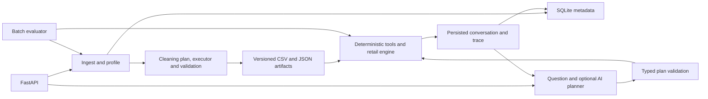

# DataPilot AI

**Walkthrough video** · YouTube link pending (3–5 minutes).

**Clean retail data, validate relationships, and trace every numerical answer to the data.**

DataPilot AI is a backend workbench for the Naukr.AI **AI Retail Data & Conversational Intelligence Workbench** assessment, under the **AI Engineering** specialization. It helps retail analysts reconcile inconsistent CSV exports, inspect cleaning decisions, compute safe retail metrics, and ask questions through a versioned, auditable assistant.

[Scoring](#2-assessment-scoring-and-coverage) · [Architecture](#3-architecture) · [Design process](#17-architecture-and-code-quality-decisions) · [Setup](#12-installation-and-setup) · [Tests](#14-running-the-tests) · [Batch](#15-batch-evaluation) · [Demo](#19-reproducible-assessment-examples)

## 1. Project overview

Upload one or more CSVs, review and validate a cleaning plan, then analyze cleaned data through Swagger or a reproducible offline batch. Implemented retail features are product/category normalization, safe relationships, and sales and inventory metrics. This project uses Swagger and HTTP as its interface.

## 2. Assessment scoring and coverage

The weights below come from page 5 of the assignment. **They are rubric weights, not a predicted score.** See the [gap audit](Reports/FINAL_ASSESSMENT_GAP_AUDIT.md) and [verification report](Reports/FINAL_ASSESSMENT_VERIFICATION_REPORT.md) for detailed evidence.

| Assessment category | Points | Implemented functionality | Source evidence | Test/evaluation evidence | Status |
| --- | ---: | --- | --- | --- | --- |
| Data profiling + cleaning correctness | 18 | Profiles CSVs and detects issues before an approval plan; validates row/schema deltas and keeps original bytes. | [ingestion_service.py](app/services/ingestion_service.py) | [Evidence](tests/test_cleaning.py) | Verified. Pending mappings are skipped; validation does not infer business meaning. |
| Retail-domain intelligence | 14 | Implements normalization, explicit safe relationships, and sales/inventory metrics. | [retail_engine.py](app/retail_engine.py) | [Evidence](tests/test_retail_uploaded.py) | Verified. No recommendation explorer; missing inputs return evidence instead of estimates. |
| Chat assistant grounding + multi-turn reasoning | 20 | Uses scoped dataset versions, computed answers and persisted conversation traces; continues filters across turns. | [assistant_service.py](app/services/assistant_service.py) | [Evidence](tests/test_module6_memory.py) | Verified for supported intents. Offline wording is narrower than model-assisted planning. |
| Safe plan execution + AI engineering | 12 | Validates typed plans, orchestrates deterministic tools, and bounds provider retries and fallbacks. | [analysis_contracts.py](app/conversation/analysis_contracts.py) | [Evidence](tests/test_assistant_analysis.py) | Verified with mock providers and offline tests; no external provider quality claim. |
| Batch evaluator + reliability | 10 | Runs cleaning, joined retail and chat through production services and continues after failed cases. | [evaluate.py](app/evaluate.py) | [Evidence](tests/test_assessment_batch.py) | Verified. IDs and timestamps differ between runs. |
| Architecture + code quality | 10 | Separates API, services, contracts, deterministic engines and persistence. API and batch reuse services; structured errors cross the boundary. | [main.py](app/main.py) | [Evidence](tests/test_api_evaluation.py) | Verified design paths. In-process processing and single-worker SQLite limit concurrency. |
| Security / privacy / data isolation | 6 | Authenticates before body parsing, enforces ownership and input/query limits, and minimizes model payloads. | [analysis_planner.py](app/conversation/analysis_planner.py) | [Evidence](tests/test_module7_reliability.py) | Verified for local deployment. Static tokens and heuristic opt-in sample redaction. |
| Automated tests | 5 | Covers profiling, mutations, integrity, safe joins, chat context, refusals and provider failure. | [conftest.py](tests/conftest.py) | [Evidence](tests/) | Verified. No production load or security certification. |
| README + technical reasoning | 5 | Documents setup, validated examples, AI boundaries and trade-offs. | [README.md](README.md) | [Evidence](Reports/ASSESSMENT_EXAMPLE_VALIDATION.md) | Verified walkthrough commands and local links. The video is a separate submission item. |
| **TOTAL** | **100** | | | | |

## 3. Architecture

FastAPI handles requests and authentication. Services coordinate CSV intake, profiling, cleaning, retail analysis and question execution. SQLAlchemy stores run metadata, versions, plans and conversation state in SQLite. The filesystem stores original and cleaned artifacts. The batch CLI calls the same services.



## 4. End-to-end workflow

Upload → preserve raw CSV → profile and detect issues → generate a plan → run authorized steps → validate schema, rows and repeatability → write a cleaned revision → execute a scoped question → save its evidence. Raw bytes remain intact. Pending or rejected operations are skipped, and the validated cleaned download is separate from the original.

## 5. AI versus deterministic code boundary

| Operation | AI responsibility | Deterministic application responsibility |
| --- | --- | --- |
| Interpret questions and plan | Optional natural-language interpretation and structured plan proposal | Offline rules for supported questions; validate field scope, revision, permissions and operations |
| Cleaning | Suggest semantic mappings or other supported cleanups | Assign risk, require approval where applicable, apply registered transforms and validate output |
| Filtering, joining, aggregation and retail metrics | None | Check join grain, execute typed tools and calculate values |
| Validation, evidence and answer | None for numerical facts | Check tool output, persist trace and render the answer from verified results |

The application never executes arbitrary model-generated Python or SQL.

## 6. AI provider and model configuration

AI defaults to off. For Groq, set `AI_ENABLED=true`, `AI_PROVIDER=openai-compatible`, `AI_BASE_URL=https://api.groq.com/openai/v1`, `AI_MODEL=openai/gpt-oss-120b`, and `AI_API_KEY` in the ignored local `.env`. The timeout defaults to 15 seconds and the default is two attempts. The uploaded-data planner stops on rate-limit responses and falls back to supported offline rules after failures. The evaluator needs no paid endpoint.

## 7. Data privacy and model boundary

The question, bounded schema and relevant relationship or metric metadata can go to the provider. Some requests also carry compact legacy context such as filter literals. Cleaning sends column statistics and issue summaries. The default sends no CSV samples. `AI_INCLUDE_SAMPLES=true` may include short, heuristically redacted samples from eligible non-identifier columns. Schema names and question text may still contain sensitive information. Raw and cleaned files, full profiles and execution evidence stay in local storage.

## 8. Security and reliability

Bearer auth runs before body parsing. Owner-scoped lookups isolate datasets, runs, conversations and traces. CSV validation covers names, types and paths, with defaults of 20 MiB per file, 100 MiB per request, 200,000 rows and five million cells. The 30-second request deadline covers body receipt. Plan allowlists, result limits and join checks bound execution. Cell text is data. Structured errors, stable upload replay with an idempotency key, atomic artifact writes and context version checks protect state. SQLite local storage is intended for one worker. The app has no built-in TLS, token expiry or tenant rate limits.

## 9. Retail-domain intelligence

Normalization reviews category or product variants and can use an explicitly approved mapping. Joins require declared keys and cardinality. Metrics reject joins that drop or duplicate base rows.

| Metric | Inputs and calculation |
| --- | --- |
| Revenue | Sum line revenue, or unit price × quantity if line revenue is unmapped. |
| Order count / AOV | Count distinct order IDs; AOV divides revenue by that count. |
| Units sold | Sum nonnegative integer quantity. |
| Return rate | Distinct orders with a returned line ÷ distinct orders × 100; requires order IDs and declared return-status values. |
| Availability / stock-out frequency | Share of on-hand observations above zero / at zero, respectively, as percentages. |
| Category / store performance | Revenue grouped by category or store. Missing dimension values are unclassified. |

Missing metric inputs yield explicit evidence. See the [retail report](Reports/MODULE_4_COMPLETION_REPORT.md).

## 10. Conversational assistant

Typed plans support filtering, sorting, grouping, comparisons, aggregates, top/bottom, distinct values, descriptive statistics, and validated joins. Offline rules accept a smaller vocabulary. Sessions retain the last verified plan and revision. Ambiguous turns ask for clarification, and unsupported questions or versions fail without replacing valid context. The trace includes the question, operation, dataset/revision, columns, filters, joins, rows considered and bounded result preview.

## 11. Project structure

```text
app/main.py          API, auth and request limits
app/services/       Shared workflow orchestration
app/conversation/   Planner, contracts, tools and memory
app/storage/        Metadata and artifacts
app/evaluate.py     Batch entry point
examples/           Small reproducible input CSVs
cases.json          Assessment cases
tests/              Unit and integration regressions
Reports/            Audit and verification evidence
```

## 12. Installation and setup

From a fresh clone in PowerShell. Verified on Windows with **Python 3.14.7**.

```powershell
python -m venv .venv
.\.venv\Scripts\python.exe -m pip install -r requirements.txt
if (!(Test-Path .env)) { Copy-Item .env.example .env }
Get-Content .env | ForEach-Object {
    if ($_ -match '^([A-Z][A-Z0-9_]*)=(.*)$') {
        [Environment]::SetEnvironmentVariable($Matches[1], $Matches[2], 'Process')
    }
}
$demoToken = [Guid]::NewGuid().ToString('N')
$env:API_TOKENS = @{ $demoToken = 'assessment-user' } | ConvertTo-Json -Compress
$demoToken
```

SQLite and relative storage initialize at startup. Copying `.env.example` alone is insufficient; the loader exports settings to this process.

## 13. Running the application

```powershell
.\.venv\Scripts\python.exe -m uvicorn app.main:app --host 127.0.0.1 --port 8000 --workers 1
```

Open [Swagger](http://127.0.0.1:8000/docs) and paste the displayed token in **Authorize**. HTTP clients send it as a bearer token. Check [health](http://127.0.0.1:8000/health) or [OpenAPI](http://127.0.0.1:8000/openapi.json).

## 14. Running the tests

```powershell
Set-Alias python (Resolve-Path .\.venv\Scripts\python.exe).Path
python -m pytest -q --basetemp "data/pytest-$((New-Guid).Guid.Substring(0,8))"
python -m pytest -q tests/test_cleaning.py tests/test_retail_uploaded.py tests/test_assistant_analysis.py tests/test_module6_memory.py tests/test_assessment_batch.py --basetemp "data/pytest-$((New-Guid).Guid.Substring(0,8))"
python -m scripts.evaluate_conversation_memory
python -m pytest -q tests/test_retail.py::test_real_cleaned_olist_regression tests/test_retail_uploaded.py::test_olist_matches_complete_accepted_enriched_summary --basetemp "data/pytest-$((New-Guid).Guid.Substring(0,8))"
```

## 15. Batch evaluation

```powershell
python -m app.evaluate --input cases.json --output results.json --artifacts-dir ./evaluation_output
```

Each [case](cases.json) has an ID and CSV paths relative to the case file. It can add approval policy, joined retail assertions, and expected chat values or statuses. JSON includes both profiles, issues, cleaning plan, validation, checks, traces and relative artifact paths. Failures are recorded and later cases continue. Values are reproducible offline; IDs and timestamps vary. Keep local outputs out of commits.

## 16. Sample datasets and reproducibility

[Teams](examples/teams.csv) has labels, case variants and an empty column. [Measurements](examples/measurements.csv) has sample IDs, readings and dates. [Sales](examples/assessment_sales.csv) has order ID, SKU, region and revenue. [Products](examples/assessment_products.csv) has product code, category and on-hand quantity. The five cleaned Olist fixtures and two summaries are already committed for regression; see the [verification report](Reports/FINAL_ASSESSMENT_VERIFICATION_REPORT.md) for provenance.

## 17. Architecture and code-quality decisions

The separate **10-point Architecture + code quality** category covers how the system is built. The design began with an inspectable, immutable cleaning trail. Explicit, versioned joins came next because a correct measure can still be inflated by duplicated rows. Typed planning, deterministic tools and persisted context then made the assistant testable with a fixed model response. Reusing the services in the batch CLI avoids a parallel evaluator implementation. FastAPI, SQLite and files keep setup and inspection simple. A separate agent framework would add little to the single validated execution path. Synchronous in-process analysis and SQLite limit concurrency and scale.

## 18. Limitations and future improvements

The project has no recommendation explorer, dedicated frontend, distributed worker queue, or production identity service. The offline assistant does not cover all free-form phrasings. Broader local phrasing and scalable execution are possible future work. Public deployment would require TLS, credential lifecycle controls and quotas. This audit does not measure live model quality or claim a submission video exists.

## 19. Reproducible assessment examples

Use Swagger with the token from setup. Paths below are relative to `/api/v1`. The [example report](Reports/ASSESSMENT_EXAMPLE_VALIDATION.md) includes exact request bodies and evidence.

1. **Clean and review an ambiguous decision.** Upload `teams.csv` as multipart `files` via `POST /ingestion/upload`. Use its file ID to inspect `GET /files/{file_id}/profile?kind=original`, `/issues` and `/cleaning-plan` under the same file route. `Blue` and `blue` might be aliases, but the file cannot establish that. The medium-risk normalization stays `AWAITING_APPROVAL`. Run `POST /files/{file_id}/clean`. Whitespace is trimmed, all three rows remain, and both labels are preserved. Check `/profile?kind=cleaned`, `/validation` and `/download` under the file route. Record a conservative decision with `POST /cleaning-steps/{step_id}/reject` and a JSON reason.
2. **Show safe retail totals.** Run the batch command on the sales and products sample case. Join `sku → product_code`. Expect Clothing **27**, Tools **10**, and total **37**. Independently, the products file has **50.0000%** stock-outs. Return rate is unsupported because return inputs are absent. Show the join and field evidence in `retail_evaluation`.
3. **Show memory and recovery.** Clean the sales CSV, then create a conversation with `POST /conversations` and `{}`. At `POST /assistant/query`, send `conversation_id`, the question, and `datasets: [{"file_id":"<sales file ID>","revision":1}]`. Ask “Show revenue by region” → **37** over three rows. Send only the conversation ID and question for “Filter to West” → **30**, then “Now show average revenue” → **15** over two rows. Inspect `GET /assistant/traces/{trace_id}`. Request revision 2 on a newly cleaned revision-1 file to see **409 `DATASET_VERSION_CONFLICT`**; the failure trace shows `NOT_STARTED`. “Continue” in the same conversation still returns **15**. The [mock outage regression](tests/test_assistant_analysis.py) separately verifies deterministic fallback without a paid provider.
