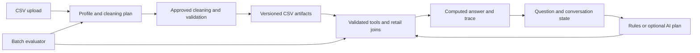

# DataPilot AI

**Clean retail data, validate relationships, and ask questions you can trace back to the numbers.**

DataPilot AI is a backend workbench for the **Naukr.AI AI Retail Data & Conversational Intelligence Workbench** assessment, under the **AI Engineering** specialization. It helps analysts turn inconsistent CSV exports into validated datasets and explainable retail metrics. A reviewer can run the demo through Swagger or reproduce the results offline with one batch command.

## Design process

| Decision | Why it mattered |
| --- | --- |
| **Make raw data and cleaning decisions inspectable first.** Preserve each original CSV, profile it, and record an approval plan before cleaning. | A reviewer can see what changed, which rows were affected, and whether the cleaned artifact passed validation. |
| **Protect the meaning of retail totals.** Require explicit fields and join keys, then check cardinality and fan-out against pinned dataset versions. | Two valid tables can still produce a wrong total if a join duplicates or drops sales rows. |
| **Give AI a typed planning role.** Let an optional model interpret questions and suggest cleanups. Let application code authorize, validate, filter, join, calculate, and render answers from verified results. | The same plan is testable offline. Model output cannot run arbitrary Python or SQL or supply a numerical result. |
| **Remember verified context and evaluate the same pipeline.** Persist the last successful plan and revision for follow-ups. Reuse the application services in the batch evaluator. | A failed or ambiguous turn does not replace useful context. An HTTP demo and a batch check exercise the same calculations. |

FastAPI, SQLite, and filesystem artifacts keep the project easy to run and inspect on one machine. An explicit planner-to-tool path is sufficient here. The trade-off is limited write concurrency and a smaller offline question vocabulary.



## Run locally

Tested on **Windows with Python 3.14.7**. In PowerShell, from a clone of this repository:

```powershell
python -m venv .venv
.\.venv\Scripts\python.exe -m pip install -r requirements.txt
if (!(Test-Path .env)) { Copy-Item .env.example .env }
Get-Content .env | ForEach-Object {
    if ($_ -match '^([A-Z][A-Z0-9_]*)=(.*)$') {
        [Environment]::SetEnvironmentVariable($Matches[1], $Matches[2], 'Process')
    }
}
$demoToken = [Guid]::NewGuid().ToString('N')
$env:API_TOKENS = @{ $demoToken = 'assessment-user' } | ConvertTo-Json -Compress
$demoToken
.\.venv\Scripts\python.exe -m uvicorn app.main:app --host 127.0.0.1 --port 8000 --workers 1
```

Open [Swagger](http://127.0.0.1:8000/docs) and enter the displayed token under **Authorize**. The health check is [`/health`](http://127.0.0.1:8000/health), and the API schema is [`/openapi.json`](http://127.0.0.1:8000/openapi.json). The app reads environment variables from the process. The commands above load the local `.env` and create a token for this demo.

## Present the project in three steps

1. **Show the data trail.** Upload [sales](examples/assessment_sales.csv) and [products](examples/assessment_products.csv) with `POST /api/v1/ingestion/upload`. For each file, show its original profile and cleaning plan, run `POST /api/v1/files/{file_id}/clean`, and inspect the cleaned profile and validation.
2. **Show why the join is safe.** In the batch results, find the sales-to-products join on `sku → product_code`. Category revenue is **27 for Clothing** and **10 for Tools**. Stock-out frequency is **50.0000%** (one of two inventory observations). Return rate is reported as unsupported because return information is missing.
3. **Show a follow-up with evidence.** Create a conversation with `POST /api/v1/conversations` and send the first question to `POST /api/v1/assistant/query` with `conversation_id` and `datasets: [{"file_id":"<sales ID>","revision":1}]`; send only `conversation_id` and `question` on follow-ups. Ask **“Show revenue by region” → 37**, **“Filter to West” → 30**, then **“Now show average revenue” → 15**. Open `GET /api/v1/assistant/traces/{trace_id}` to show the cleaned revision, applied filter, rows considered, plan, and computed result.

## Reproduce the assessment

Run from the repository root with the virtual environment's Python:

```powershell
Set-Alias python (Resolve-Path .\.venv\Scripts\python.exe).Path
python -m app.evaluate --input cases.json --output results.json --artifacts-dir ./evaluation_output
python -m scripts.evaluate_conversation_memory
python -m pytest -q
```

The [batch cases](cases.json) specify input files, cleaning decisions, optional join and metric checks, and expected chat outcomes. Results include before/after profiles, quality issues, the cleaning plan, validation, retail and chat evidence, and relative artifact paths. Failed cases do not stop later cases. Generated outputs stay local. The committed Olist fixtures support the [real-data regression](tests/test_retail.py); no raw download is needed.

| Assessment area | Evidence |
| --- | --- |
| Profiling and cleaning | [Ingestion](tests/test_ingestion.py), [quality checks](tests/test_quality.py), [cleaning validation](tests/test_validation.py) |
| Retail intelligence | [Normalization, safe joins, sales and inventory checks](tests/test_retail_uploaded.py). Revenue sums declared line values or price × quantity. Average order value divides revenue by distinct orders. |
| Assistant and AI Engineering | [Planning, fallback and safety](tests/test_assistant_analysis.py), [persisted multi-turn context](tests/test_module6_memory.py) |
| Batch, security and reproducibility | [Batch checks](tests/test_assessment_batch.py), [reliability tests](tests/test_module7_reliability.py), [clean-clone results](Reports/FINAL_ASSESSMENT_VERIFICATION_REPORT.md) |

## AI, privacy, and scope

AI is **off by default**. To use Groq, set `AI_ENABLED=true`, `AI_PROVIDER=openai-compatible`, `AI_BASE_URL=https://api.groq.com/openai/v1`, and `AI_MODEL=openai/gpt-oss-120b` with your own `AI_API_KEY` in the ignored `.env`. Provider calls default to a 15-second HTTPX timeout and two attempts. If the provider fails, supported questions can fall back to offline rules.

Planners receive the question and bounded schema, relationship or metric metadata, sometimes including compact prior filters. Cleaning sends bounded profile statistics and issue summaries. Full CSV rows stay local by default. Opt-in cleaning samples are heuristically redacted, and schema names and questions may still contain sensitive text.

The demo uses static bearer tokens, owner-scoped access, request and result limits, and single-worker SQLite. It has no built-in TLS, tenant rate limits, or recommendation explorer. For exact endpoint examples, metric formulas, and verification results, see the [retail report](Reports/MODULE_4_COMPLETION_REPORT.md), [gap audit](Reports/FINAL_ASSESSMENT_GAP_AUDIT.md), and [verification report](Reports/FINAL_ASSESSMENT_VERIFICATION_REPORT.md).
